<!--
  ⚠️  Arquivo gerado por scripts/generate-readme.mjs — não edite à mão.
      Edite data/profile.json e rode: npm run build
-->

  

  <i>Angular, React &amp; React Native no front, Node/Go/Python no back — de app mobile a overlay em tempo real.</i>

  
  
  

 

  

Desenvolvedor fullstack focado em aplicações web e mobile. No dia a dia trabalho com **Angular + TypeScript** e backends em **Node.js**, e nos projetos pessoais exploro **Go**, **Python** e integrações com APIs de terceiros (Spotify, YouTube, Supabase).

Gosto de projeto que **roda de ponta a ponta**: interface, API, banco e deploy. A maior parte do que está aqui foi construída assim — não são exercícios soltos, são sistemas completos.

- 🧩 Arquitetura de frontend: separação container/apresentação, custom hooks, organização por feature
- ⚙️ Backends e integrações: REST, autenticação, permissões por papel, real-time
- 📱 Mobile com React Native + Expo, consumindo API própria
- 🖥️ Também construo desktop: GUIs em Python empacotadas como executável
- 🚀 Deploy: Render, GitHub Actions, Firebase Hosting

 

  

  <b>◢ LINGUAGENS</b> 
  
  
  
  

  <b>◢ FRONTEND</b> 
  
  
  
  
  
  
  

  <b>◢ BACKEND, DADOS & INFRA</b> 
  
  
  
  
  
  

 

  

  

  <code>EP I</code> Qui-Gon & Obi-Wan × Darth Maul &nbsp;·&nbsp; <code>EP III</code> Obi-Wan Kenobi × Anakin Skywalker &nbsp;·&nbsp; <code>EP III</code> Yoda × Darth Sidious &nbsp;·&nbsp; <code>EP IV</code> Obi-Wan Kenobi × Darth Vader &nbsp;·&nbsp; <code>EP V</code> Luke Skywalker × Darth Vader &nbsp;·&nbsp; <code>EP VI</code> Luke Skywalker × Darth Vader

 

  

### 🏥 [Clínica App — Sistema de Gestão de Clínicas](https://github.com/Gabriel00V-dev/Projeto-LP-6) 

> **Projeto principal** · aplicação **mobile + API** completa, desenvolvida em equipe — sou o maior contribuidor do repositório (32 de 47 commits).

Plataforma que centraliza dados de clínicas, pacientes e especialidades médicas. Resolve a dispersão de informação e o cadastro duplicado com um controle unificado, e dá ao paciente acesso mobile à busca de clínicas por especialidade.

**Mobile:** `React Native` `Expo SDK 54` `TypeScript` `React Navigation` + design system próprio  
**API:** `Node.js` `Express` `TypeScript` `Supabase` (PostgreSQL, auth e sync em tempo real)

- 🔐 **Autenticação dupla** — fluxos distintos para paciente e clínica
- 🔎 Busca avançada com filtro por especialidade médica
- 📋 CRUD completo de clínicas, pacientes e especialidades
- 🏗️ Monorepo `mobile/` + `backend/` com workflows de CI
- 🎨 Componentes de UI próprios, reaproveitados em todas as telas

`M-001` &nbsp; `SETOR` Núcleo · Coruscant &nbsp; `CLASSIFICAÇÃO` Equipe · 32 de 47 commits

Projeto acadêmico — não destinado a uso em produção.

---

### 🎛️ [IROS — Overlay](https://github.com/olimpio00/Overlay) 

Sistema de **overlay em tempo real para OBS**, controlado pelo navegador. Cria sessões e entrega **editor e viewer separados**, para que o streamer edite em uma janela enquanto o OBS captura a outra — sem recarregar a cena. Suporta texto, imagem, áudio, vídeo, timers e iframes.

`ARMAMENTO` · `Go` `JavaScript` `HTML/CSS` — backend em Go servindo templates e assets

> Arquitetura em camadas (`cmd/`, `core/`, `meta/`), estado de sessão em tempo real e configuração via `.env`.

`M-002` &nbsp; `SETOR` Rede de transmissão &nbsp; `CLASSIFICAÇÃO` AGPL-3.0 · solo

---

### 🎴 [GachArena](https://github.com/olimpio00/GachArena) 

Sistema de **gacha** com temática de animes (Bleach, Naruto, One Piece, Dragon Ball): abertura de caixas temáticas, raridade de personagens, mecânica de drop expansível e coleção do usuário.

`ARMAMENTO` · `TypeScript` `Angular` `Node.js` `GitHub Actions` — monorepo `frontend/` + `backend/` com pipeline de CI

> Modelagem de probabilidade e raridade — a parte difícil é garantir que o drop rate seja justo *e* auditável.

`M-003` &nbsp; `SETOR` Bordas Exteriores &nbsp; `CLASSIFICAÇÃO` Solo · 36 de 36 commits

---

### 🛒 [ProdutorStore](https://github.com/olimpio00/produtor-store) 

E-commerce em **Angular 17** com catálogo de produtos, consumindo API mockada via `json-server` e proxy de desenvolvimento.

`ARMAMENTO` · `Angular 17` `TypeScript` `JSON Server`

`M-004` &nbsp; `SETOR` Rotas comerciais &nbsp; `CLASSIFICAÇÃO` Solo

---

### ⚛️ [Refactory-React](https://github.com/olimpio00/Refactory-React) 

Estudo prático de **arquitetura de frontend**: refatoração de um `ProductPage` monolítico em uma estrutura escalável.

`ARMAMENTO` · `React` `TypeScript` `Vite`

Cinco princípios aplicados:

1. Separação de responsabilidades
2. Divisão container / apresentacional
3. Extração de custom hooks (`useProducts`)
4. Organização por feature (`features/products/`)
5. Componentes de UI agnósticos à fonte de dados

`M-005` &nbsp; `SETOR` Treinamento &nbsp; `CLASSIFICAÇÃO` Estudo de arquitetura

---

### 🎵 [Player Music](https://github.com/olimpio00/player-music) 

**Player de música desktop** com interface inspirada no Spotify. Suporta MP3/WAV/OGG/FLAC, shuffle inteligente sem repetição, playlists persistidas em JSON, mini-player e **teclas de mídia funcionando em background**.

`ARMAMENTO` · `Python 3.11` `tkinter` `Pygame` `Mutagen` `PyWin32` `PyInstaller`

> Empacotado como `.exe` via PyInstaller. Integração com as media keys do Windows foi a parte mais interessante.

`M-006` &nbsp; `SETOR` Sinais &nbsp; `CLASSIFICAÇÃO` MIT · desktop

---

### ⬇️ [Spotify → YouTube Downloader](https://github.com/olimpio00/Spotify-YouTube-Downloader) 

App desktop para baixar **faixas e playlists do Spotify** (resolvidas via YouTube) em MP3, e vídeos do YouTube de 240p até **4K 60fps com upscaling automático**.

`ARMAMENTO` · `Python` `CustomTkinter` `yt-dlp` `Spotipy` `FFmpeg`

> Integração com a Spotify Web API + pipeline de conversão em FFmpeg, com progresso em tempo real na UI.

`M-007` &nbsp; `SETOR` Contrabando &nbsp; `CLASSIFICAÇÃO` Solo · desktop

---

### 🗂️ [Star Wars Fan Wiki](https://github.com/olimpio00/Star-Wars-Fan-Wiki) · [🌐 ao vivo](https://star-wars-fan-wiki.onrender.com) 

**Gerenciador de arquivos** com tema Star Wars: upload/download, organização em pastas e categorias, autenticação e **permissões por papel** (admin / usuário padrão). Responsivo em mobile.

`ARMAMENTO` · `Python` `NiceGUI` `Supabase` (auth + storage + database)

`M-008` &nbsp; `SETOR` Arquivos &nbsp; `CLASSIFICAÇÃO` MIT · Render

---

### 🕵️ [Andor Missions](https://github.com/olimpio00/Andor-Missions) 

CRUD de **missões no universo de Cassian Andor** — infiltração, sabotagem, reconhecimento e exfiltração. Pequeno, rápido e pronto para deploy.

`ARMAMENTO` · `Python` `Flet` `Supabase` — deploy declarativo via `render.yaml`

`M-009` &nbsp; `SETOR` Inteligência rebelde &nbsp; `CLASSIFICAÇÃO` Solo · 10 de 10 commits

---

### 🎓 Missões de treinamento

| Projeto | Descrição | Stack |
|---|---|---|
| [Estagio-etapa-2](https://github.com/olimpio00/Estagio-etapa-2) | Webapp de social media | `Angular` `TypeScript` |
| [Estagio-etapa-1](https://github.com/olimpio00/Estagio-etapa-1) | Backend da etapa inicial | `JavaScript` `Node.js` |

 

  

  <picture>
    <source media="(prefers-color-scheme: dark)" srcset="https://raw.githubusercontent.com/olimpio00/olimpio00/master/assets/stats-dark.svg?v=01feee84">
    <source media="(prefers-color-scheme: light)" srcset="https://raw.githubusercontent.com/olimpio00/olimpio00/master/assets/stats-light.svg?v=01feee84">
    
  </picture>

  Atualizado automaticamente por GitHub Actions a partir da API do GitHub.

 

  

  
  

 

  

